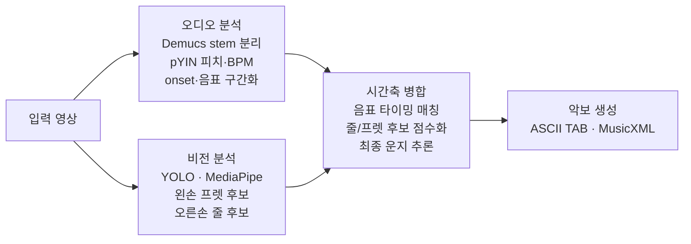

# AutoTabStudio · 연주 영상 기반 악보 자동 생성

> 오디오 피치 분석과 비전 손 위치 분석을 결합해, 베이스 연주 영상을 TAB·MusicXML 악보로 자동 변환하는 멀티모달 시스템

**2025 캡스톤디자인 2** · 4인 팀 프로젝트 (2025.09 – 2026.03) · **2026.10 개인 개선**

`Python` · `librosa (pYIN)` · `Demucs` · `YOLO` · `MediaPipe` · `OpenCV` · `music21`

> **이 저장소에 대해**
> 캡스톤 제출 당시 코드는 [`v1-team-submission`](../../tree/v1-team-submission) 태그에 그대로 남아 있습니다.
> 이후 커밋은 제가 평가 기준을 새로 만들고, 코드를 다시 읽으며 찾은 문제를 고친 뒤 결과를 수치로 측정한 개인 작업입니다. 아래 [개선 기록](#개선-기록-202610)에 정리했습니다.

---

## 개요

기타·베이스는 **같은 음을 여러 줄과 프렛에서** 연주할 수 있어, 오디오만으로는 실제 운지 위치를 알 수 없습니다. 반대로 영상만으로는 정확한 피치와 음의 시작 지점을 안정적으로 얻기 어렵습니다.

AutoTabStudio는 **오디오는 피치·타이밍을, 영상은 줄·프렛 후보를** 담당하도록 역할을 나눈 뒤, 두 결과를 **시간축 기준으로 병합**해 최종 운지를 추론합니다. 결과는 ASCII TAB과 MusicXML로 내보내 MuseScore 같은 악보 프로그램에서 바로 열 수 있습니다.

## 파이프라인



## 핵심 구현

**1. 오디오 분석 파이프라인** — 전체 음원에서 바로 피치를 추정하면 반주·노이즈의 영향을 받기 때문에, **Demucs로 베이스 stem을 분리한 뒤** 분석합니다. librosa 기반 **pYIN**으로 시간 프레임별 피치를 추정하고 BPM·음표 시작·종료를 계산해, 연속 피치 흐름을 음표 단위 JSON 타임라인으로 저장합니다. 같은 음을 다시 친 것인지 판단할 수 있도록 음의 시작(onset) 시각도 함께 저장합니다. 이 타임라인이 이후 비전 결과와 매칭되는 기준이 됩니다.

**2. 비전 분석과 결과 병합** — 영상 프레임에서 YOLO 객체 탐지와 MediaPipe 손 좌표로 왼손 프렛 후보·오른손 줄 후보를 프레임별로 저장하고, 별도 JSON으로 생성되는 좌/우손 결과를 시간 기준으로 정렬해 하나의 `vision_frames.json`으로 병합합니다.

**3. 운지 추론과 악보 생성** — 같은 시간대의 오디오(음높이·타이밍)와 비전(손 위치) 결과를 비교하고, 베이스 튜닝 규칙으로 가능한 줄/프렛 조합을 점수화해 최종 운지를 추론합니다. 결과를 실제 사용 가능한 악보 산출물로 변환합니다.

## 커스텀 YOLO 데이터셋 구축

공개 데이터셋이 없어 유튜브·핀터레스트 등에서 기타·베이스 연주 이미지 **약 1,000장을 직접 수집**하고 Roboflow로 어노테이션해 커스텀 YOLO 모델을 학습했습니다.

| 구분 | 1차 모델 | 2차 모델 (개선) |
| --- | --- | --- |
| 목적 | 악기의 구조적 요소 검출 | 연주 장면의 손 위치·프렛 영역 검출 |
| 클래스 | board, nut, fret, string | board, nut, fret zone, left/right hand |
| 프렛 라벨링 | 개별 프렛 단위 | 프렛 영역 단위 |
| 손 라벨링 | 없음 | 왼손/오른손 전체 영역 |

> 1차 모델에서 현(string) 클래스는 AP 약 65%에 그쳤습니다. 현은 얇고 배경과 구분이 어려워 각도·조명 영향을 크게 받기 때문에, 개별 검출을 고집하는 대신 **손 위치와 프렛 영역을 함께 해석하는 방식**으로 전환했고, 이 판단이 최종 운지 추론에 필요한 정보를 안정적으로 확보하는 전환점이 되었습니다.

## 개선 기록 (2026.10)

### 평가 기준 만들기
제출본에는 결과를 정답과 비교하는 코드가 없었습니다. 그래서 기준 악보와 평가 스크립트부터 만들었습니다.

- **기준 악보**: '참치크래커 베이스' 채널의 WOODZ - Drowning 베이스 커버 영상([YouTube](https://youtu.be/Ul6qZAgf7_E))은 연주와 함께 화면에 TAB과 재생 커서를 보여 줍니다. 이 화면에서 음마다 줄·프렛·시작 시각을 반자동으로 읽어 **732음짜리 기준 악보**를 만들고, 화면 21쪽을 하나씩 대조해 확인했습니다. 악보는 연주자의 저작물이라 저장소에는 넣지 않았습니다.
- **정답 기준** ([`evaluation/evaluate_tab.py`](evaluation/evaluate_tab.py)): 기준 음과 결과 음을 시작 시각 ±0.1초 안에서 1:1로 짝짓고, **피치·줄·프렛이 모두 맞은 음 수 ÷ 기준 음 수**를 정답률로 계산합니다. 화면 커서와 오디오 사이의 고정 지연은 전체 오프셋을 탐색해 맞춥니다.

### 결과

| 버전 | 운지까지 남은 음 | 피치 정확도 | 정답률 (비전 없이) | **정답률 (비전 포함)** |
| --- | --- | --- | --- | --- |
| 제출본 | 4 / 671 | 0.0% | 0.0% | **0.0%** |
| ① 개방현 수정 | 99 | 10.1% | 7.5% | **9.6%** |
| ② 반복음 병합 수정 | 648 | 85.0% | 69.7% | **83.6%** |

- 오디오 단계(Demucs + pYIN)는 제출본에서도 시작 시각 F1 0.925, 피치 정확도 87.6%로 잘 동작했습니다. 문제는 그 결과를 운지로 바꾸는 단계에 있었습니다.
- 비전을 넣으면 정답률이 69.7%에서 83.6%로 오릅니다. 피치가 맞은 622음 중 612음(98.4%)이 줄·프렛까지 맞았습니다. 같은 음을 낼 수 있는 여러 줄 가운데 실제로 친 줄을 고르는 데 비전 결과가 역할을 하고 있습니다.

### 1. 개방현이 기타 튜닝으로 들어가 있던 문제
운지 계산의 개방현 MIDI 값이 베이스(E1·A1·D2·G2 = 28·33·38·43)가 아니라 **기타 아래 4줄(E2·A2·D3·G3 = 40·45·50·55)**이었습니다. 베이스 음은 대부분 MIDI 40보다 낮아서 "칠 수 있는 줄·프렛이 없음"으로 처리되어 버려졌고, 오디오에서 찾은 671음 중 **4음만** 악보에 남았습니다. 남은 음도 실제보다 12프렛 낮은 위치로 계산됐습니다.

### 2. 같은 음 반복이 한 음으로 합쳐지던 문제
오디오 단계는 8분음표로 같은 음을 반복하는 부분을 음 단위로 잘 나눴지만, 운지 단계 마지막의 병합 함수가 **간격 0.05초 이하인 같은 위치 음을 모두 하나로 합쳐** 574음이 사라졌습니다. 이 병합은 길게 끄는 음이 피치 흔들림으로 잘게 쪼개진 경우를 이어 붙이려는 것이라, 그냥 지우지 않고 조건을 추가했습니다.

- 베이스 stem에서 `librosa.onset`으로 음의 시작 시각을 검출해 오디오 결과 JSON에 저장합니다. 검출된 onset은 실제 음 시작과 중앙값 0.014초 차이였습니다.
- 두 번째 음의 시작 ±0.06초 안에 onset이 있으면 **다시 친 음**으로 보고 병합하지 않습니다. 이 조건으로 반복음 574쌍 중 551쌍이 따로 남았습니다.
- 병합을 아예 없앤 경우(비전 없이 71.3%)보다 1.6%p 낮은데, onset을 찾지 못한 반복음 23쌍이 여전히 합쳐지기 때문입니다.

### 3. 지금 환경에서 실행되지 않던 문제
| 문제 | 수정 |
| --- | --- |
| 최신 mediapipe(1.x)에는 손 검출 코드가 쓰는 `mp.solutions`가 없음 | `mediapipe==0.10.14` 고정 |
| torchaudio 2.9 이상은 torchcodec 없이 wav를 저장하지 못해, Demucs가 분리를 끝낸 뒤 저장 단계에서 실패 | `torch`·`torchaudio` 2.8.0 고정 |

### 남은 과제
- **곡이 하나뿐입니다.** Drowning은 E·A 두 줄의 1~6프렛만 쓰는 곡이라, 높은 프렛이나 다양한 줄 이동이 있는 곡에서는 결과가 다를 수 있습니다. 같은 방식으로 기준 악보를 더 만들 계획입니다.
- 이제 남은 오류는 대부분 **피치** 쪽입니다(피치 정확도 85.0%). pYIN 최저 주파수(40Hz)가 프레임 길이(2048)에 비해 낮아 최저음 근처 검출이 불안정하다는 경고가 나옵니다(이 곡의 최저음 F1 = 43.7Hz).
- MusicXML의 `<string>` 번호가 뒤집혀 있습니다. MusicXML은 1번이 가장 높은 줄(G)인데, 코드는 1번을 E줄로 씁니다. 정답률(`solved_notes.json` 기준)에는 영향이 없지만, MuseScore에서는 줄이 거꾸로 보입니다.
- CPU에서는 느립니다. 4분짜리 영상 기준 Demucs(shifts=10) 약 40분, 왼손 검출 약 2시간, 오른손 검출 약 3.5시간이 걸렸습니다.

## 담당 역할 (캡스톤 당시)

- **오디오 분석 파트** — 피치·BPM 추정과 음표 구간화 구현. 음정 추정 라이브러리(librosa, CREPE, basic-pitch)를 비교해 pYIN 기반 방식을 채택하고, 비전과 병합 가능한 시간 정보 기반 JSON 구조 설계
- **커스텀 YOLO 데이터셋 구축** — 연주 이미지 약 1,000장 직접 수집·Roboflow 어노테이션, 클래스 구성이 다른 모델 2종 학습·비교
- **오디오·비전 결과 병합** — 음표 타이밍 기준 비전 프레임 매칭, 베이스 튜닝 규칙 기반 줄/프렛 후보 계산 로직 구현

## 기술 스택

| 구분 | 기술 |
| --- | --- |
| Language | Python (CLI · JSON 기반 파이프라인) |
| Audio | librosa (pYIN, onset), Demucs, soundfile, SciPy |
| Vision | OpenCV, MediaPipe, Ultralytics YOLO, PyTorch, Roboflow |
| Score Export | music21, MusicXML, ASCII TAB |
| Data / Experiment | pandas, scikit-learn, Pillow, PyYAML |

## 실행 방법

```bash
python -m venv .venv && .\.venv\Scripts\activate
pip install torch==2.8.0 torchvision==0.23.0 torchaudio==2.8.0 --index-url https://download.pytorch.org/whl/cpu
pip install -r requirements.txt

# 원본 영상에서 전체 분석
python run_full_pipeline.py --video data/videos/test_video.mp4 --no_display

# 기존 오디오/비전 결과 재사용 (병합~MusicXML만 재실행)
python run_full_pipeline.py --video data/videos/test_video.mp4 \
  --audio_json outputs/audio/result.json \
  --left_json outputs/vision/left_frames.json \
  --right_json outputs/vision/right_frames.json \
  --skip_audio --skip_vision_detection --no_display

# 기준 악보와 비교
python evaluation/evaluate_tab.py --reference data/reference/drowning_tab.json \
  --audio outputs/audio/result.json --solved outputs/solve/solved_notes.json
```

- 가상환경을 **활성화한 상태**로 실행해야 합니다. 오디오 단계가 `demucs`를 명령어로 부르기 때문에, 활성화하지 않으면 다른 Python 환경의 Demucs가 실행될 수 있습니다.
- Windows에서 경로에 한글 등 ASCII가 아닌 문자가 있으면 MediaPipe가 모델 파일을 열지 못합니다. 가상환경은 영문 경로에 두는 것을 권장합니다.

## 프로젝트 구조

```text
run_full_pipeline.py     # 전체/부분 파이프라인 실행
run_audio_analysis.py    # 오디오 피치·BPM·onset·음표 분석
src/
  audio/                 # pYIN 피치 분석, onset 검출, 음표 구간화
  detect_left_hand_frets.py / detect_right_hand_strings.py
  merge_hand_vision.py   # 좌/우손 비전 결과 병합
  run_tab_solver.py      # 줄/프렛 추론
  export_musicxml.py     # MusicXML 내보내기
evaluation/
  evaluate_tab.py        # 기준 악보와 음 단위 비교
outputs/                 # 실행 결과 (JSON, TAB, MusicXML)
docs/PROJECT_STRUCTURE.md
```

> 입력 영상·오디오·모델 가중치·기준 악보는 저작권과 용량 때문에 로컬에만 두고 Git에서는 제외합니다.
